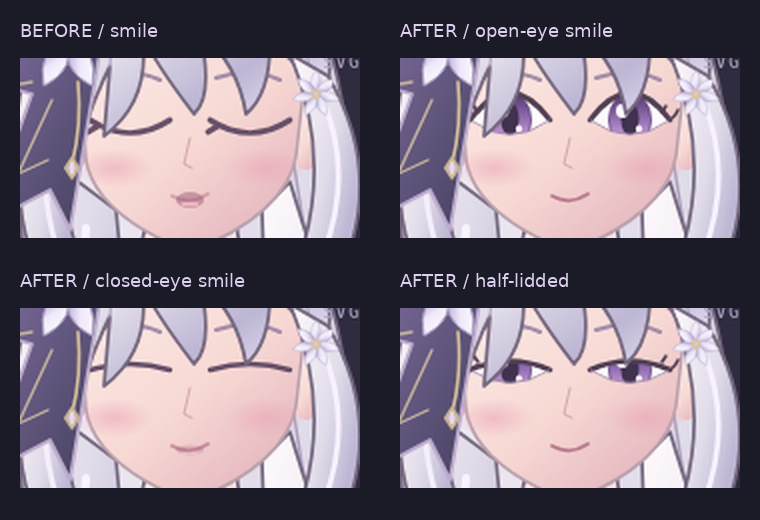

# 眼睛與表情品質修正

保留尚未提交的第二階段動畫、所有互動與效能優化；本輪只重畫眼睛，沒有重新設計角色。修正前的工作目錄已先存入忽略的 `outputs/eye-review/before/`，不是用 Git checkout 還原或覆寫它。

## 修正原因與做法

舊版 `happy` 將眼睛整組做 Y 軸 scale 到約 0.08，包含虹膜、瞳孔及高光。新版不縮放任何眼球內容，而是用一致的 SVG path 同時控制眼白、clipPath、上下眼皮。眨眼時只有 aperture 收合，虹膜保持固定位置與尺寸，並由 clipPath 遮住。

重新繪製杏仁眼曲線、紫色漸層虹膜、深色瞳孔、雙高光、虹膜下緣反光，以及朝外眼角的睫毛。沒有改動原有髮型、服裝、身材與配色。與保存的第二階段素材逐檔比較，27 組圖層中僅兩眼的 SVG / PNG 發生變化；其餘圖層位元組完全一致。合成母版與 manifest 雜湊隨眼睛更新。

## 表情

| API 值 | UI | 眼睛表現 |
| --- | --- | --- |
| `happy` | 微笑（預設） | 約 94% 睜眼、眼角輕彎、閉嘴柔和笑線 |
| `closedSmile` | 閉眼微笑 | 明確閉眼弧線，與眨眼形狀共用安全幾何 |
| `halfLidded` | 半瞇眼 | 約 50% 開合，獨立選項，絕不自動套用到普通微笑 |
| `neutral` | 平靜 | 完整睜眼，保留手動開合控制 |
| `surprised` | 驚訝 | 睜眼與張嘴反應，保留第二階段動作 |

各表情繼續使用阻尼權重淡入淡出，沒有改成突跳。暫停時選擇表情會即時更新，方便靜態檢查。眼睛手動參數仍會乘上表情的開合程度；需要精確的 0..1 無表情眼型時選 `neutral`。API 舊有 `happy` 名稱維持相容，但現在代表普通睜眼微笑。

## 可驗證圖片

同一 600×1100 SVG 畫布、固定姿態、關閉自動眨眼與身體動態，使用真實 Chromium 截圖裁出相同區域。比較板僅作 2 倍等比放大與加註，沒有修圖掩蓋問題。左上為修改前第二階段 `happy`，右上為新普通微笑，下排為明確分開的閉眼微笑與半瞇眼。它是向量測試角色的品質改善，不宣稱等同精緻商業插畫。

## 測試及發布狀態

- 全部 Python／瀏覽器測試：25 passed，包含既有接縫像素、FPS、連動與互動測試。
- JavaScript 測試：10 passed，新增獨立表情開合、眼皮不反轉、完全閉合幾何。
- 完整眨眼取樣驗證眼白與 aperture path 相同，虹膜的 bbox / CTM 不變，眼球組未套用 scale。
- 預設與 reset 均為睜眼微笑；保留手動參數、衣髮連動、待機、波形口型與三種互動。
- GitHub Pages 工作流程仍僅能手動 dispatch，本次 commit / push 不會自動部署。第二階段與眼睛更新尚需使用者另行確認部署，iPhone 上現有站點不會因本輪操作自動改版。

目前仍是 2D 分層動畫原型，沒有 `.moc3`、Cubism Core 或 Editor 依賴。
